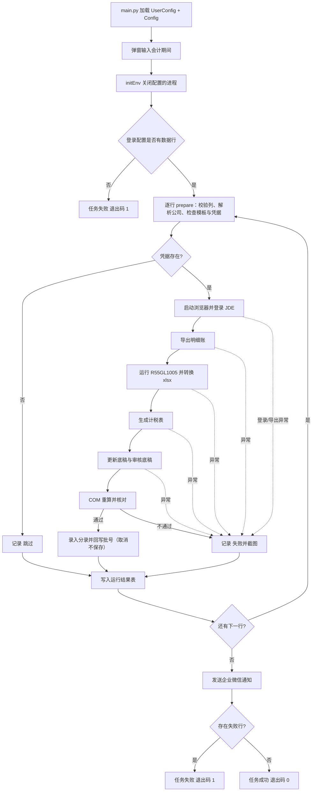

# JDE 房产税 RPA 程序说明文档

编写日期：2026-10-30。本文依据当前工作区源代码编写，面向使用、运维及后续开发人员；功能描述以代码实现为准。

## 0. 版本说明（2026-10-30）

当前版本与旧版文档的主要差异：

- 主流程改为按「登录配置」页逐行执行：每一行是一个「凭据 + 共享盘目录」，完整跑一遍登录、导出、生成计税表、更新底稿、重算核对和分录录入。
- 每行执行结果写入年度运行结果表，全部行结束后按 `WechatRobotN` 页配置发送企业微信通知。
- 运行前弹出会计期间输入框，留空或 60 秒无操作按自然月运行。
- Windows 通用凭据不存在时，该行标记为「跳过」，不计入失败；凭据存在但读取失败、用户名/密码为空仍计为失败。
- 模块六（日记帐分录录入）已实现：按计算底稿 G:J 整块粘贴到 JDE，并回写批号；但当前实现为「录入后取消两次、不保存」，批号不会在 JDE 中留存。
- 模块四已切换为 Check 条件驱动（`check_update.py`）+ R55GL1005 审核底稿重建（`audit_update.py`）；`template_update.update_legacy()` 仅保留旧算法用于旧版回归。
- 同名计税表输出会被直接覆盖；旧文档中「已存在则拒绝执行」的规则已不适用。
- 模块五核对在存在 `R55GL1005` 页时执行四项（含审核差额），不存在时执行三项。

## 1. 程序概述

本项目使用 Python 开发，通过 Playwright 操作 JDE 网页，通过 openpyxl 读写工作簿，通过 Windows COM（Excel/WPS）写入模板、重算公式和转换 JDE 报表，完成从租房产税底稿的数据整理、核对与分录录入。

单行业务链路：

```text
读取配置 → 会计期间弹窗 → 初始化环境 → 启动浏览器 → 登录 JDE →
导出明细账 → 运行并下载 R55GL1005 → 生成计税表 → 更新底稿与审核底稿 →
COM 重算并核对 → 录入日记帐分录（取消不保存）→ 关闭浏览器 → 写入运行结果表
```

全部行结束后发送企业微信通知，并根据是否存在失败行决定任务结果。

### 1.1 当前实现范围

| 模块 | 当前能力 | 实现状态 |
| --- | --- | --- |
| 一：登录 JDE | 按行读取 Windows 通用凭据，填写环境、角色并登录 | 已实现 |
| 二：导出明细账 | 登录后导出明细账，再运行 R55GL1005 并下载、转换 | 已实现 |
| 三：生成计税表 | 按标题导入明细账，保留模板其他工作表及公式 | 已实现 |
| 四：更新底稿 | Check 条件驱动汇总计税金额，并按 R55GL1005 重建审核底稿 | 已实现，依赖约定模板布局 |
| 五：重算核对 | COM 重算后核对税额、收入、审核差额与 Check 明细 | 已实现 |
| 六：写入分录 | 整块粘贴 G:J 分录行并回写批号；当前录入后取消、不保存 | 已实现（开发模式） |
| 批量调度 | 按「登录配置」逐行运行、结果表、企业微信通知 | 已实现 |

**任务退出码只表示批量是否发生失败，不表示业务是否全部保存。** 分录录入当前被取消、不落库；出现「待补运行」时任务仍可能返回成功。

## 2. 项目结构与职责

```text
项目根目录/
├── main.py                         主程序入口（配置、弹窗、初始化、主任务）
├── run.bat                         Windows 启动脚本（优先使用 .venv）
├── record_jde.py                   登录后打开 Playwright Inspector 录制
├── keep_awake.py                   独立运行的定时鼠标微动工具
├── requirements.txt                Python 依赖清单
├── config/
│   ├── config.py                   配置合并、目录生成与配置归档
│   ├── config_loader.py            Excel 配置读取、多行配置、ConfigError
│   └── property_tax_ledger_headers.json  明细账模板标题定义（46 列）
├── core/
│   ├── task_base.py                任务执行、日志、状态与耗时管理
│   ├── context.py                  共享配置、业务数据与浏览器实例
│   └── task_manager.py             可选串行任务管理器（当前未使用）
├── workflows/jde_flow/
│   ├── main_task.py                逐行编排、逐行参数、结果表与通知
│   ├── login_task.py               获取凭据并执行登录
│   ├── property_tax.py             模块二至六编排、模板写入与保存
│   ├── check_update.py             Check 条件驱动的计税/分录公式更新
│   ├── audit_update.py             由 R55GL1005 重建审核底稿及蓝色分类
│   ├── template_update.py          外部链接备份、旧版更新算法
│   ├── template_check.py           COM 重算、xls 转换、金额核对
│   └── run_report.py               运行结果表与企业微信通知
├── web/
│   ├── browser.py                  Playwright 浏览器封装
│   ├── base_page.py                通用网页操作封装（当前主链路未使用）
│   └── JDE/jde_function.py         JDE 登录、明细账/R55GL1005 导出、分录录入
├── data_processing/excel.py        通用 Excel 读写封装（当前主链路未使用）
├── client/                         Windows 客户端自动化封装（当前未使用）
├── utils/
│   ├── credentials.py              Windows 通用凭据读取
│   ├── period_dialog.py            会计期间输入弹窗
│   ├── helpers.py                  时间戳、目录、耗时格式化、重试装饰器
│   ├── file_utils.py               文件复制/移动/备份等
│   └── screenshot.py               整屏截图工具（主链路未使用）
├── init/init.py                    进程清理、可选分辨率设置
├── log/loggingConfig.py            日志初始化
├── data/                           配置文件、模板与示例输出
└── tests/                          单元测试与手动联调脚本
```

## 3. 环境与安装

### 3.1 运行条件

- Windows 桌面环境：配置弹窗、Windows 通用凭据、COM 调用均依赖 Windows。
- Python 3（项目未固定版本），需能安装 Playwright 与 pywin32。
- 可访问目标 JDE 系统的网络环境。
- 当前 Windows 登录用户下已保存对应的「通用凭据」。
- 安装 Microsoft Excel（默认 `Excel.Application`），并具备写入 Excel「受信任位置」的权限（R55GL1005 转换需要）。
- 共享盘目录可读写（计税表模板与输出均位于共享盘）。

### 3.2 依赖

以 `requirements.txt` 为准：`openpyxl>=3.1.0`、`Pillow>=10.0.0`、`psutil>=5.9.0`、`pywin32>=305`、`playwright>=1.40.0`、`uiautomation>=2.0.0`。另需标准库 `tkinter`（会计期间弹窗）。

### 3.3 安装

```powershell
python -m venv .venv
.\.venv\Scripts\Activate.ps1
python -m pip install -r requirements.txt
python -m playwright install chromium
```

### 3.4 Excel 与受信任位置

- R55GL1005 的 `.xls` 模板自带宏，处理逻辑挂在 `Workbook_Open` 事件上。
- 转换时先把文件复制到 Excel「受信任位置」再打开，并设置 `AutomationSecurity=1`（等同点击“启用内容”）；**不能关闭 `EnableEvents`**，否则宏不执行。
- 找不到可写的受信任位置时，日志会告警，宏可能不运行，转换结果需人工比对。
- 受信任目录会跳过 `XLSTART`，避免 Excel 启动时自动加载临时文件；转换完成后临时文件会被删除。

## 4. 配置说明

### 4.1 配置文件与加载规则

主入口加载 `data/UserConfig.xlsx`（用户配置）与 `data/Config.xlsx`（系统配置），两个文件都必须存在：

- 普通配置页：第 1 行为标题，第 2 行起 A 列为配置项、B 列为值；C 列说明不读取。A 列为空或 B 列为 `None` 的行不载入。
- 多行配置页（如「登录配置」）：第 1 行作为列标题，第 2 行起每行一条记录；全空行跳过；字符串去除首尾空格。
- 同一 `工作表.配置项` 以 `UserConfig.xlsx` 为优先，其余由 `Config.xlsx` 补充。
- 多行配置页在 `UserConfig.xlsx` 中无数据行时，回落到 `Config.xlsx` 的同名页；用户页有数据时以用户页为准。
- 程序用 `工作表名.配置项` 访问配置，例如 `JDE配置.jde_url`；`Config.get_rows(页名)` 读取多行配置。

`main.py` 的配置路径为相对 `main.py` 所在目录的 `./data/UserConfig.xlsx` 与 `./data/Config.xlsx`。

### 4.2 基础配置与目录配置

| 工作表 | 配置项 | 默认值 | 说明 |
| --- | --- | --- | --- |
| 基础配置 | 项目名称 | `JDE流程` | 用于工作目录名称 |
| 基础配置 | 基础路径 | `./data` | 相对路径按配置文件所在目录的上一级解析，默认即项目根目录 |
| 基础配置 | 初始化进程列表 | 空 | 英文或中文逗号分隔；按进程名**子串匹配**终止进程 |
| 目录配置 | 配置目录 | `01_配置` | 两个配置工作簿的归档目录 |
| 目录配置 | 输入目录 | `02_输入` | 模板、手工明细账等输入 |
| 目录配置 | 输出目录 | `03_输出` | 明细账、R55 报表以及按行创建的数据目录 |
| 目录配置 | 日志目录 | `04_日志` | 运行结果表写入此目录；业务日志仍在 `log_data` |
| 目录配置 | 截图目录 | `05_错误截图` | 失败截图 |
| 目录配置 | 临时目录 | `06_临时文件` | 预留 |

工作目录为 `基础路径/项目名称/目录名称`。`main.py` 启动时会创建全部目录，并把两个源配置工作簿复制到配置目录（仅在目标不存在时复制）。

`initEnv()` 按「初始化进程列表」关闭进程，属于子串匹配，例如配置 `excel` 会关闭所有名称包含 `excel` 的进程；启动前应保存相应应用中的数据。`set_resolution()` 已定义但当前未调用。

### 4.3 JDE配置

| 配置项 | 必填 | 说明 |
| --- | --- | --- |
| jde_url | 是 | JDE 登录地址；任务启动前校验非空，为空直接失败 |
| jde_credential_name | 是 | Windows 通用凭据目标名称；主流程中会被「登录配置」的 `window凭据` 逐行覆盖 |
| jde_environment | 否 | 登录环境，如 `JPD920`；非空时填写 |
| jde_role | 否 | 登录角色，如 `*ALL`；非空时填写 |
| headless | 否 | 默认 `False`；字符串接受 true/false、1/0、yes/no（不区分大小写），其他值报错 |

- 登录时环境变量 `JDE_URL`、`JDE_ENVIRONMENT`、`JDE_ROLE` 分别覆盖对应配置值；即使设置了 `JDE_URL`，仍要求配置文件中的 `jde_url` 非空。
- 账号密码不从环境变量读取：`utils/credentials.py` 用当前 Windows 用户调用 `CredRead(..., CRED_TYPE_GENERIC, ...)`，密码按 UTF-16-LE 解码。

凭据读取结果与处理方式：

| 情况 | 处理 |
| --- | --- |
| 凭据名称为空 | `ValueError`；主流程中会先被「登录配置」必填校验拦截 |
| 凭据不存在（WinError 1168） | 抛出 `CredentialNotFoundError`，该行记为「跳过」，不计失败 |
| 其他读取失败（权限、类别错误等） | 抛出 `RuntimeError`，该行记为「失败」 |
| 用户名为空或密码为空 | 抛出 `RuntimeError`，该行记为「失败」 |
| 密码不是有效 UTF-16-LE | 抛出 `RuntimeError`，该行记为「失败」 |
| 未安装 pywin32 | 抛出 `RuntimeError`，该行记为「失败」 |

凭据存在时，「登录配置」中的 `凭据账号` 会与凭据用户名的域前缀之后部分比较（忽略大小写）；不一致只记录 warning，仍使用凭据中的真实账号登录。

配置凭据：Windows「凭据管理器 → Windows 凭据 → 添加普通凭据」，填写目标名称、用户名、密码，再把目标名称填入 `window凭据` 或 `jde_credential_name`。

### 4.4 登录配置（多行，主流程入口）

「登录配置」页每一行对应一个账号与一个共享盘目录，程序按行完整跑一遍流程。

| 列名 | 必填 | 说明 |
| --- | --- | --- |
| window凭据 | 是 | Windows 通用凭据目标名称 |
| 凭据账号 | 是 | 与该凭据用户名比对，仅用于告警，不参与登录 |
| 共享盘路径 | 是 | 目录绝对路径，末段必须是「公司简称 公司代码」两个词，如 `N:\...\太古汇 2501` |

校验与派生规则：

- 三个必填列任一为空：该行报错并记为失败，其他行继续。
- 共享盘路径末段必须恰好两个词且第二个为纯数字；否则该行失败。
- 公司简称取末段第一个词，用于模板名与计税表文件名；公司代码取第二个词并左补零到 5 位（`2501` → `02501`）。
- 共享盘目录下必须存在模板 `房产税计税表 {公司简称}.xlsx`，否则该行失败。
- 数据目录为 `输出目录/{公司简称} {公司代码} {YYYYMM}`，每行独立，自动创建。
- 行内其它列不读取，可自行保留备注。

### 4.5 房产税配置

以下配置项可写在任一配置工作簿的 `房产税配置` 页。主流程会在每行执行前用「登录配置」覆盖其中大部分键（见 5.2）。

| 配置项 | 默认值 | 主流程是否覆盖 | 说明 |
| --- | --- | --- | --- |
| 会计期间 | 空 | 由弹窗写入 | 空或仅空格按当月；支持 `YYYY-MM`、`YYYY/MM`、`YYYYMM`、`YYYY年M月`；用于文件名、导出日期区间与结果表期间 |
| 公司 | 空 | 是 | 文件名用公司简称；不得含 `<>:"/\|?*` 等非法字符 |
| 模板文件 | 空 | 是 | 显式模板路径；相对路径按输入目录解析；主流程固定为共享盘模板 |
| 明细账文件 | 空 | 是 | 导出目标；相对路径按输出目录解析；主流程为数据目录下的无后缀名 |
| 明细账工作表 | 源文件第一张 | 否 | 明细账工作表名 |
| 明细账标题行 | `1` | 否 | 必须为正整数 |
| 模板标题行 | 标题定义文件中的 `1` | 否 | 必须为正整数 |
| 标题映射 | 空 | 否 | JSON 对象，方向「源标题 → 模板标题」，覆盖默认别名 |
| 输出目录 | 空 | 是 | 空时用框架输出目录；相对路径作为框架输出目录的子目录；主流程为共享盘目录 |
| 收入科目匹配方式 | `精确` | 否 | 仅接受 `精确` 或 `包含子科目` |
| 重算引擎 | `Excel.Application` | 否 | WPS 可尝试 `ket.Application`；`openpyxl` 跳过 COM（会丢失图片、数据验证等对象） |
| 核对容差 | `0.00` | 否 | 非负有限金额 |
| 明细账分类帐类型 | `AA` | 否 | 明细账查询的分类账类型 |
| 明细账自公司 | 空 | 是 | 导出必填；主流程为公司代码 |
| 明细账至公司 | 空 | 是 | 导出必填；主流程为公司代码 |
| R55GL1005文件 | 空 | 是 | 本期报表目标；相对路径按输入目录解析；主流程为数据目录下的 `.xlsx` |
| R55GL1005工作表 | 报表第一张 | 否 | 读取报表的工作表名 |
| 计算底稿工作表 | `房产税（从租）计算底稿` | 否 | 更新与核对使用的工作表 |
| 分录工作表 | `房产税（从租）计算底稿` | 否 | 读取 G:J 分录区与回写批号 |
| 分录公司 | `02501` | 是 | 分录 Document Company；主流程为公司代码 |

补充说明：

- 输出文件名统一为 `房产税计税表 公司 YYYYMM.xlsx`，期间取会计期间所在月。
- 模块三支持自定义模板标题行，但模块四固定按 `JDE明细账` 与审核底稿第 1 行读取标题，完整运行时应保持标题在第 1 行。
- 更新底稿时会把计算底稿中「会计期间：」右侧单元格写为**执行当天日期**（`yyyy/m/d`），不是配置的会计期间。

### 4.6 企业微信通知配置

配置工作簿中可建立 `WechatRobot1`、`WechatRobot2`…（正则 `^WechatRobot\d+$`，不区分大小写），每个工作簿页对应一个机器人：

- Webhook 地址读取顺序：该页多行内容中任意以 `http` 开头的值（列名可为 `webhook`、`webhook_url`、`url`、`地址`、`机器人地址`）；其次读取 `WechatRobotN.webhook` 等键。
- 未配置 Webhook 的机器人跳过；单个机器人发送失败只记录 warning，不影响其他机器人。
- 先发送文本消息，再上传并发送运行结果表文件；上传失败视为该机器人发送失败。
- 没有任何可用机器人时只记录日志，不报错。

## 5. 主流程与业务规则



### 5.1 启动、会计期间弹窗与环境初始化

1. `main.py` 加载 `UserConfig.xlsx` 与 `Config.xlsx`，创建目录并归档配置。
2. 弹出 tkinter 输入框（置顶、居中）：
   - 输入合法期间（`2026-10`、`202610`、`2026/10` 等）并确定：写入 `房产税配置.会计期间`。
   - 留空确定、按 Esc、关闭窗口、60 秒无按键/点击或弹窗无法显示：清空会计期间，按当月运行。
   - 格式非法时红字提示并重置倒计时。
3. 调用 `initEnv()` 按配置关闭进程。
4. 创建 `JDEMainTask` 并执行。

日志同时输出到控制台（stderr）与 `./log_data/YYYYMMDD_机器名.log`；该路径相对进程工作目录，`run.bat` 会先切到项目根目录。

### 5.2 主任务逐行编排

`JDEMainTask.execute()`：

1. 校验 `JDE配置.jde_url` 非空。
2. 读取「登录配置」数据行；为空时直接失败，提示需要填写 `window凭据`、`凭据账号`、`共享盘路径`。
3. 计算本次会计期间标签（`YYYYMM`，空则当月）。
4. 逐行执行，每行开始前清空上下文中的 `property_tax_status`、`property_tax_pending_reason`、`jde_journal_batch`。

每行 `prepare()` 依次完成：

- 三列必填校验；
- 解析共享盘路径（公司简称、公司代码，代码补零到 5 位）；
- 检查共享盘与模板 `房产税计税表 {简称}.xlsx`；
- 读取凭据（不存在则抛 `SkipRun`，结束本行）；
- 计算会计期间、数据目录并创建；
- 写入以下覆盖项：

| 覆盖键 | 值 |
| --- | --- |
| JDE配置.jde_credential_name | 本行 `window凭据` |
| 房产税配置.公司 | 公司简称 |
| 房产税配置.模板文件 | 共享盘/`房产税计税表 {简称}.xlsx` |
| 房产税配置.输出目录 | 共享盘目录 |
| 房产税配置.明细账自公司 / 至公司 | 5 位公司代码 |
| 房产税配置.分录公司 | 5 位公司代码 |
| 房产税配置.明细账文件 | 数据目录/`JDE明细账 {时间戳}`（无后缀） |
| 房产税配置.R55GL1005文件 | 数据目录/`R55GL1005_{时间戳}.xlsx` |

随后 `run_one()` 处理本行：新建 `BrowserManager`（`headless` 来自配置）、启动、执行 `JDELoginTask`、执行 `PropertyTaxFlow`；异常时若页面可用则截图到 `05_错误截图/jde_failure_{简称}_{代码}.png`，最后在 `finally` 中关闭浏览器。

单行结果判定：

| 上下文 `property_tax_status` | 运行结果 | 是否计入失败 |
| --- | --- | --- |
| `completed` 或未设置 | 成功 | 否 |
| `pending` | 待补运行 | 否（异常情况写 pending 原因） |
| 其他值 | 失败 | 是 |
| prepare 抛 `SkipRun` | 跳过 | 否 |
| 其他异常 | 失败 | 是 |

每行无论成功、失败、待补运行还是跳过，都会立即写入运行结果表；全部行处理完后发送通知。只要存在失败行，通知发送后抛出 `ConfigError("以下账号执行失败：…")`，任务失败，`main()` 返回 `False`，退出码 1。

### 5.3 登录与浏览器管理

- 每次登录重试最多 3 次，间隔 5 秒；重试只包裹登录函数，不覆盖房产税流程。
- `jde_login()`：打开 `jde_url`；若 `#drop_mainmenu` 5 秒内可见则视为已登录；否则按需点击 `Details`，填写 Environment、Role（非空时）、User ID、Password，点击 `Sign In`，等待主菜单 20 秒。
- 登录成功后设置上下文 `jde_logged_in=True`；浏览器在同行的导出、分录环节复用。

### 5.4 模块二：导出明细账

`PropertyTaxFlow.export_ledger()`：

- 校验 `明细账自公司`、`明细账至公司` 非空，浏览器已打开。
- 日期区间：优先上下文 `jde_ledger_start`/`jde_ledger_end`；否则用上下文 `jde_ledger_period` 或 `会计期间` 的自然月首末日；统一格式化为 `MM/DD/YYYY`。
- 目标文件取 `明细账文件`（相对路径按框架输出目录解析），未配置时输出目录 `/房产税明细账 {时间戳}`；无后缀时按下载建议的文件名补后缀。
- 页面操作：选择页面 → 所有页面 → 总帐；按科目帐的帐户查询；填写分类账类型 2（默认 `AA`）、自公司、至公司、起始日期、至日期；查找；转到结束；选择所有提取的记录；输出网格数据；本地文件系统 + 输出到 Excel + 新工作簿 + 所有；点击「继续」触发下载（超时 300 秒），保存到目标路径。
- 成功后设置上下文 `jde_ledger_path`。

### 5.5 模块二续：R55GL1005 导出与转换

`export_r55gl1005()`：

- 校验 `明细账自公司`（主流程为 5 位公司代码）。
- 目标路径优先上下文 `jde_r55gl1005_path`，其次 `R55GL1005文件`（相对路径按输入目录解析），都没有时输出目录 `/R55GL1005_{时间戳}.xlsx`；后缀强制为 `.xlsx`。
- 页面操作：回到主页 → 总帐 → 中方科目总账；版本填 `TKHXLS001` 回车；选择所有提取记录 → 选择 → 数据选择 → 提交(U) → 确定；在 Company 选择框中填写去掉前导零的公司代码 → 确定 → 屏幕(F) → 已提交作业；「作业」框填 `R55GL1005_TKHXLS001` 回车。
- 作业定位：取「已提交作业」列表第一行（即本次提交），解析作业号后按作业号跟踪该行；页面不会自动刷新，轮询期间每 5 秒在「作业」框重新填作业名并回车；总轮询上限 120 秒。
- 状态判定：行文本包含「完成/Done」即完成；包含「错误/失败/Error」立即报错；超时或未完成不下载。
- 下载：点击「可单击图标 查看输出」，在原页面或新开页面监听下载，保存为同名 `.xls`（原始文件保留），随后转换为 `.xlsx`（同名不同后缀），并关闭下载过程中新开的页面。
- 转换规则：复制到可写的 Excel 受信任位置 → `AutomationSecurity=1` 打开 → 优先 `SaveAs(51)` 直接保存为 xlsx（保留格式）；被安全策略阻止时退回读取各表 UsedRange 值重建 xlsx（保留数值、文本及原行列位置，去除末尾空行空列，工作表名非法字符替换为 `_` 且不超过 31 字符并去重；公式与格式不保留），日志打印每张表的行列数。临时文件最终删除。
- 成功后设置上下文 `jde_r55gl1005_path`。

### 5.6 模块三：生成计税表

`create_template(ledger_path)`：

1. 模板：配置 `模板文件`（相对输入目录）优先；否则在输入目录查找名称包含「房产税计税表」的 `.xlsx`，排除 `~$` 临时文件和明细账本身，必须唯一。
2. 校验 `公司` 非空且不含 `<>:"/\|?*` 及控制字符。
3. 期间取会计期间所在月（`YYYYMM`）；输出目录为 `输出目录`（相对路径挂在框架输出目录下）或框架输出目录；输出文件 `房产税计税表 公司 YYYYMM.xlsx`。
4. 输出路径不得与模板或明细账相同；同名输出已存在时**直接删除并覆盖**。
5. `标题映射` 必须是字符串到字符串的 JSON 对象。
6. 按 `config/property_tax_ledger_headers.json` 校验模板标题集合：当前定义 46 列，模板缺少任一预期标题即失败。
7. 标题处理：去首尾空格、保留内部空格；同名标题忽略空格、下划线、连字符、`+ / ( )`、全角括号后自动匹配；重复标题失败；标题定义文件中的默认别名先应用（当前 46 列的 `source_header` 均为空，未配置别名），配置 `标题映射` 最后覆盖。
8. 所有源标题都必须映射；多个源标题指向同一模板标题失败；模板所需列全部要有来源；明细账无数据行失败。
9. 写入：明细账工作表取 `明细账工作表` 或第一张；源/模板标题行为正整数。
   - `重算引擎` 为 `openpyxl`：清空映射列旧值后逐行写入，沿用首条明细样式，设置打开时全量重算，保存后回写外部链接部件。
   - 其他引擎：复制模板到输出路径，用 Excel 写入（纯文本列临时设为文本格式避免 `00100` 变 `100`），数据行超出模板时从首条明细复制格式，`CalculateFullRebuild` 后保存；失败则删除半成品；Excel 不可用时自动回退 openpyxl 写入。
10. 设置上下文 `property_tax_path`、`jde_ledger_rows`、`jde_ledger_mapping`。

### 5.7 模块四：更新底稿

`update_template(path)`：

1. 校验 `收入科目匹配方式` 只能是 `精确` 或 `包含子科目`。
2. 计算底稿工作表取 `计算底稿工作表`（默认 `房产税（从租）计算底稿`），必须存在。
3. 把「会计期间：」右侧单元格写为执行当天日期（`yyyy/m/d`）；找不到该文字直接失败。
4. 本期 R55GL1005：优先上下文 `jde_r55gl1005_path`，其次 `R55GL1005文件`；都没有时进入 `PendingModule`（待补运行），提示配置报表文件。
5. 用报表工作表（`R55GL1005工作表` 或第一张）整体替换工作簿中的 `R55GL1005` 页：复制值、样式、合并区域、批注。
6. `update_workbook()` → `check_update.update_from_check()`（见下）。
7. 设置打开时全量重算；读取原有定义名 `蓝色` 的引用；保存（Excel 优先、openpyxl 回退）。
8. 设置上下文 `property_tax_bu_totals`。

Check 条件驱动规则（`check_update.py`）：

- 从计算底稿第 5 行起读取 Check 区：M 列单据类型、O 列账号；O 列有值即视为一条条件；没有条件视为旧版模板，直接失败；`(账号, 单据类型)` 重复失败；`非` 后没有类型失败。
- 按条件遍历 `JDE明细账`（第 2 行起）汇总 `分类帐类型 1 金额`：
  - 账号默认精确匹配；`包含子科目` 时额外匹配以 `账号.` 开头的科目；
  - 单据类型为 `非 XX` 时排除 XX，其余精确等于；
  - 金额用 `Decimal` 累加；金额为空、非数值或非有限值时失败（提示具体科目）。
- P 列写入 `SUMPRODUCT` 实时汇总公式（账号用 `TRIM` 比较，子科目用 `LEFT(...)=账号&"."`，排除类型用 `MID(Mr,2,99)`；布尔结果乘 1 后求和）；最后一个条件下方写 `=P5+P6+…` 作为 Check 合计。
- 明细区从第 9 行起按 `(BU, 单据类型)` 分组生成行，BU 取账号 `.` 前部分：
  - B 列 BU（数字字符串写为整数）；
  - C 列 `=-SUM(P条件单元格…)`（同分组多条件相加后取反）；
  - D 列 `=ROUND(C{行}*$C$8,2)`；
  - 固定 BU `250108` 固定放在明细区最后且只出现一次，C 列保留/生成 `=LOOKUP($C$4,MOH!$E$6:$AF$6,MOH!$E$7:$AF$7)`；
  - 「合计」行 B 列写「合计」，C/D 列写 `=SUM(...9:...{合计行-1})`。
- 分录区：G 列账号以 `.917013` 结尾时，H 列借项写对应 BU 全部税额行 `=$D$x+$D$y…`（无行则 `=0`）；I 列公式中的 D 列引用按行位移重写，被移除的行引用归零。
- 工作簿含 `R55GL1005` 页时，继续执行 `audit_update.update_audit()`。

审核底稿重建规则（`audit_update.py`）：

- 在前 30 行内唯一定位 `Cat23` 表头；校验 A:E 为 `Cat23`、`Object Account`、`Subsidiary`、`Subledger`、`Account Description`，G:H 为 `Debits`、`Credits`。
- 以 C:F 四列为键，从审核底稿第 8 行起记录已有科目的样式，用于新数据沿用格式。
- 从 Cat23 表头下一行读取报表，Cat23 有值的行切换分组：说明为「主营业务收入」或「其他业务收入」时进入该分组并记住组起始行；两个分组都必需且不能重复。
- 分组内每行必须是审核底稿已有科目（C:F 键），否则报错「出现未分类科目，请先复核计税分类」。
- 从第 8 行起清空 B:I，按顺序写入 B:I（值 + 原样式），I 列 `=H{行}-G{行}`；I 列填充色为 `FF00B0F0` 的行组成「蓝色」区域。
- 重建定义名 `蓝色`，指向所有蓝色单元格的 I 列；M8/N8、M9/N9 分别引用主营业务收入、其他业务收入分组行；`N10=SUM(蓝色)`，`N11=N8+N9-N10`，`N12=LOOKUP($D$4,MOH!$E$6:$AF$6,MOH!$E$7:$AF$7)`，`N14=N11+N12-计算底稿!C{合计行}`，`D4=计算底稿!C4`。

保存规则：

- Excel 路径：逐单元格写入差异（`R55GL1005` 页整表覆盖，不参与差异比较），公式以 `Formula` 写入，日期用 Excel 序列号避免时区偏差，先复制旧合计行格式到新合计行、再把第 9 行格式套用到数据行，`CalculateFullRebuild` 后保存。
- openpyxl 回退：直接保存并回写外部链接部件；定义名 `蓝色` 随工作簿保留。

### 5.8 模块五：重算与核对

`compare_values(path)`：

1. 状态置 `running`。
2. `recalculate_file()`：
   - 校验文件存在、非空、zip 成员完整、可被 openpyxl 打开；
   - `DispatchEx(engine)` 新建独立实例，隐藏窗口、关闭警告、`AutomationSecurity=3`；
   - 以 `UpdateLinks=0` 打开，若为只读则报错「生成文件被占用」；
   - `CalculateFullRebuild()` 后保存并关闭。
3. 以 `data_only=True` 重新加载，调用 `check_sheet()`。
4. 核对项（容差默认 `0.00`，判定 `|左-右| ≤ 容差`）：

| 核对项 | 左值 | 右值 |
| --- | --- | --- |
| 税额合计=借项汇总 | 计算底稿合计行税额列（D） | 借项金额列（H）中 G 列账号以 `.917013` 结尾的各行之和 |
| 收入合计=审核计税收入+MOH | 合计行收入列（C） | 审核底稿 N11 + N12 |
| 审核差额=0 | 审核底稿 N14 | 0 |
| Check合计=Check明细汇总 | Check 区合计公式单元格 | Check 明细金额之和 |

工作簿没有 `R55GL1005` 页时只核对三项：税额合计=借项汇总、收入合计=-Check合计、Check合计=明细汇总。

定位方式：按表头文字「BU」「借项金额」「分类帐类型1金额」和「合计」「250108」标记定位，不依赖固定行号；标记不唯一、数值缺失、公式未产生数值都直接失败。逐项结果写入日志和上下文 `property_tax_check_results`，状态写 `passed`/`failed`。任一项不通过时只打印 `表格核对失败：{不通过项}`、把失败原因写入 `property_tax_pending_reason` 并返回 `False`，不抛代码异常；`PropertyTaxFlow.run()` 据此跳过分录，把本行标记为失败，主任务在运行结果表写入失败原因，日志中不会出现堆栈。全部通过时返回 `True`，随即执行模块六（当前 `compare_values()` 通过后固定返回 `True`，因此核对通过一定会进入分录）。

### 5.9 模块六：分录录入

`write_journal(path)`：

1. `journal_rows()`：在计算底稿（`分录工作表`）前 30 行内定位同时含「帐号 / 借项金额 / 贷项金额 / 备注」的标题行；从下一行起读到账号为空为止；说明取第一条分录的备注；没有数据行则失败。
2. `create_journal_entry()`：
   - 回主页 → 总帐 → 日记帐分录；点「增加 (Ctrl+Alt+A)」→「确定 (Ctrl+Alt+O)」；
   - 读取并记录 JDE 生成的批号；
   - 填写 Document Company（`分录公司`）、说明、总帐日期（当天，`MM/DD/YYYY`）；
   - 将 G:J 按 Tab 分隔、行间换行的 TSV 写入系统剪贴板（数值去掉多余小数位，避免科学计数法）；
   - 选择分录方案（`#gtab0_1`，默认值 `8d5afde055f149ea973fb07587dafa28`）；
   - 把焦点移到分录网格首格（只认网格内输入框获得焦点，失败即终止，避免粘贴到日期栏）；`Ctrl+V` 整块粘贴；
   - `discard=True`（当前默认）：点击「取消 (Ctrl+Alt+L)」两次退出，**不保存**。
3. 把批号回写到计算底稿「批号：」右侧单元格；设置上下文 `jde_journal_batch`、`jde_journal_rows`。

> 当前分录录入用于联调：能验证粘贴、批号与回写，但 JDE 中不会留下已保存的分录。正式启用前需去掉两次取消并补充保存/提交后的结果确认。

### 5.10 运行结果表

- 位置：`04_日志/房产税计税表更新与分录录入运行结果表-{当年年份}.xlsx`；首次创建时写标题并设置列宽、宋体居中、冻结首行。
- 每处理完一行追加一条记录，列：会计期间、公司、公司代码、分录批号、运行结果、异常情况、运行开始时间、运行结束时间；异常情况自动换行，时间格式 `yyyy/m/d h:mm:ss`；自动维护筛选区域。
- `运行结果` 取值：成功、失败、待补运行、跳过。
- 公司/公司代码优先取 `prepare()` 解析值；`prepare()` 在解析公司前失败时，从共享盘路径重新解析，解析不了则保留原始路径。
- 结果表写入失败只记录 warning，不影响业务结果。

### 5.11 企业微信通知

- 通知文本：`各位好，请查收 {公司}_房产税计税表更新与分录录入，谢谢！`、`本次处理会计期间：{YYYYMM}`、`总处理行数：{N} 行，处理成功：{S} 个，失败/待补运行：{F} 个，具体查看《{结果表文件名}》`。
- 总处理行数不含「跳过」行；失败数 = 总处理行数 − 成功数（即失败 + 待补运行）。
- 公司列表为结果中出现的公司简称去重后以「、」连接；没有时取 `房产税配置.公司`，再没有用「太古汇」。
- 除文本外会尝试上传结果表文件并发送文件消息。

### 5.12 状态、异常与退出码

`TaskBase.run()` 捕获 `execute()` 的异常：正常返回即 `completed` 并返回 `True`；异常则 `failed` 并返回 `False`。`main()` 返回 True/False，`__main__` 转为退出码 0/1。

| 场景 | 任务状态 | 退出码 |
| --- | --- | --- |
| 所有行成功或跳过 | completed | 0 |
| 存在失败行 | failed（汇总报错） | 1 |
| 登录配置为空 | failed | 1 |
| `jde_url` 为空 | failed | 1 |
| 配置缺失/加载失败（主任务之前） | 未进入主任务，抛出异常 | 1 |
| 全部行跳过 | completed | 0 |

## 6. 使用步骤

### 6.1 首次准备

1. 安装依赖与 Chromium（见第 3 节）。
2. 在两个配置工作簿中填写 `基础配置`、`目录配置`、`JDE配置`、`房产税配置`、`登录配置`、`WechatRobotN`。
3. 在 Windows 凭据管理器中创建每行所需的通用凭据。
4. 在每个共享盘目录放置模板 `房产税计税表 {公司简称}.xlsx`，并确认模板包含 `JDE明细账`、`房产税（从租）计算底稿`、`房产税（从租）审核底稿`、`MOH` 等工作表及约定的 Check 区、分录区。
5. 在 Excel 信任中心添加可写的受信任位置（R55GL1005 宏需要）。

### 6.2 常规运行

```powershell
run.bat
```

或：

```powershell
python main.py
```

`run.bat` 优先使用 `.venv\Scripts\python.exe`，结束后显示「运行完成」或「运行失败，退出码：N」并暂停。

运行后检查：

- 控制台/`log_data` 日志中的逐行参数、跳过/失败原因、核对明细；
- 运行结果表；
- 企业微信通知（如已配置）；
- 各行数据目录中的明细账、R55 报表与共享盘中的计税表。

### 6.3 录制与联调脚本

```powershell
python record_jde.py
python record_jde.py --credential-name "JDE凭据目标名称"
```

录制脚本加载同样配置，强制有界面浏览器，登录成功后调用 `page.pause()` 打开 Inspector；`--credential-name` 只覆盖本次运行的凭据名，不修改工作簿。

`tests/manual_*.py` 为依赖真实 JDE/Excel 的手动联调脚本：

| 脚本 | 作用 |
| --- | --- |
| manual_login_export.py | 登录并导出明细账/R55GL1005 |
| manual_journal_entry.py | 验证分录录入 |
| manual_probe_account_query.py | 探测账户查询页面 |
| manual_probe_r55_output.py | 探测 R55GL1005 提交与输出 |
| manual_template_pipeline.py | 模板生成与更新联调 |
| manual_template_update.py | 底稿更新联调 |

### 6.4 鼠标微动辅助工具

```powershell
python keep_awake.py
python keep_awake.py -i 10
python keep_awake.py --duration 3600
```

独立运行，默认每 30 秒检查鼠标位置，未变化时微动后复位；`Ctrl+C` 停止。它未接入主程序，也不能覆盖系统或组织配置的全部锁屏策略。

## 7. 输出、日志与上下文

### 7.1 文件输出

| 输出 | 位置 |
| --- | --- |
| 计税工作簿 | 共享盘目录/`房产税计税表 {公司简称} {YYYYMM}.xlsx`（同名覆盖） |
| 明细账 | `03_输出/{公司简称} {代码} {YYYYMM}/JDE明细账 {时间戳}.xlsx` |
| R55GL1005 原始文件 | 同目录/`R55GL1005_{时间戳}.xls` |
| R55GL1005 工作簿 | 同目录/`R55GL1005_{时间戳}.xlsx` |
| 运行结果表 | `04_日志/房产税计税表更新与分录录入运行结果表-{年份}.xlsx` |
| 配置归档 | `01_配置/UserConfig.xlsx`、`01_配置/Config.xlsx` |
| 运行日志 | 进程工作目录下 `log_data/YYYYMMDD_机器名.log` |
| 失败截图 | `05_错误截图/jde_failure_{公司简称}_{公司代码}.png` |

`04_日志` 目录会被创建，但 logger 实际仍写入 `log_data`（`config/config.py` 的 `PYHON_LOG_FOLDER_PATH = "./log_data/"`）。

### 7.2 失败截图

- 仅当浏览器页面仍可用时截图；`prepare()` 阶段失败（缺列、路径非法、模板缺失、凭据不存在）不截图。
- 文件名按公司与代码固定，同一公司后续失败会覆盖上一张。

### 7.3 上下文关键字段

| 字段 | 含义 |
| --- | --- |
| jde_logged_in | 登录成功标记 |
| jde_ledger_path | 本次导出的明细账路径（可预先注入） |
| jde_ledger_start / jde_ledger_end / jde_ledger_period | 可选：明细账日期区间或期间，优先于配置 |
| jde_r55gl1005_path | 本期 R55GL1005 路径（可预先注入） |
| property_tax_path | 生成的计税表路径 |
| jde_ledger_rows / jde_ledger_mapping | 导入行数与源→模板标题映射 |
| property_tax_bu_totals | BU、科目、单据类型及汇总金额记录 |
| property_tax_status | `running`、`pending`、`failed`、`completed` |
| property_tax_pending_reason | 待补运行原因 |
| property_tax_check_status | `running`、`passed`、`failed` |
| property_tax_check_results | 逐项核对记录（左值、右值、差额、容差、通过、位置） |
| journal_required | 模块五返回的布尔决策 |
| jde_journal_batch / jde_journal_rows | 分录批号与行数 |

上下文仅保存在内存中，不形成持久化状态文件。

## 8. 错误处理与常见问题

| 现象 | 原因与处理 |
| --- | --- |
| 启动即失败：配置文件不存在 | 检查 `data/UserConfig.xlsx`、`data/Config.xlsx` 是否存在 |
| 会计期间弹窗未出现 | tkinter 不可用或远程会话限制；程序会按自然月继续，日志有 warning |
| 整批不执行：登录配置无数据行 | 在「登录配置」页填写 `window凭据`、`凭据账号`、`共享盘路径` |
| 某行被跳过 | 该行 `window凭据` 在凭据管理器中不存在；确认名称或补齐凭据后重跑 |
| 某行失败：无法读取 Windows 通用凭据 | 凭据类别不是「通用凭据」、当前用户无权限或 pywin32 未安装 |
| 某行失败：共享盘路径末段格式不正确 | 目录名必须是「公司简称 公司代码」，如 `太古汇 2501` |
| 某行失败：共享盘缺少模板 | 目录下需要 `房产税计税表 {公司简称}.xlsx` |
| 浏览器无法启动 | 未安装 Chromium 或 Playwright 依赖缺失 |
| 登录失败 | 检查 `jde_url`、环境、角色、凭据；页面控件变化也会导致失败；最多重试 3 次 |
| 明细账导出超时 | 检查网络、查询条件、页面加载；网格 300 秒、下载 300 秒 |
| R55GL1005 作业长时间未完成 | 检查作业状态；轮询上限 120 秒，超时不下载 |
| R55GL1005 转换结果异常 | 检查是否配置了可写的 Excel 受信任位置、宏是否执行；日志会打印各表行列数 |
| 模板标题缺失/未映射 | 对照 `property_tax_ledger_headers.json` 检查源表与模板，必要时补 `标题映射` |
| 生成失败：输出与输入重合 | 调整模板、明细账或输出目录 |
| 底稿更新报「Check 区没有账号筛选条件」 | 模板为旧版；需使用含 M:O 条件与 P 列公式的新版模板 |
| 底稿更新报「出现未分类科目」 | R55GL1005 出现审核底稿未收录的科目；先在模板中补充科目分类与蓝色标记后重跑 |
| 底稿更新报「无法唯一定位 Cat23 表头」 | 报表结构或工作表选择不对；检查 `R55GL1005工作表` 配置 |
| 待补运行：R55GL1005 导出待录制 | 独立运行且未配置报表路径；主流程会自动导出，通常不会出现 |
| COM 重算失败或文件被占用 | 关闭占用该文件的 Excel；检查重算引擎注册与写入权限 |
| 核对无法取数 | 公式未计算出数值、表头标记缺失或重复；检查模板与重算结果 |
| 核对金额不符 | 查看日志中的左值/右值/差额与位置，复核金额符号、税率 `$C$8`、固定 BU 250108 与 MOH 数据 |
| 分录未出现在 JDE | 当前实现录入后取消两次、不保存，属预期行为 |
| 企业微信未收到通知 | 检查 `WechatRobotN` 的 webhook、网络；未配置时只记录日志 |

## 9. 测试与维护

### 9.1 单元测试

```powershell
python -m unittest discover -s tests -v
```

现有测试文件与覆盖范围：

| 文件 | 覆盖内容 |
| --- | --- |
| test_credentials.py | 通用凭据读取、错误信息不泄露凭据内容、空名称 |
| test_jde_flow.py | 逐行编排、登录与浏览器清理、失败截图、空登录配置、prepare 派生公司/路径/期间 |
| test_property_tax.py | 标题映射与列重排、非法输出、R55 保存与转换顺序 |
| test_check_update.py | Check 条件汇总、非 XX 过滤、未分类科目阻断 |
| test_template_update.py | 旧版汇总算法：带符号金额、精确/子科目、固定 BU、动态公式 |
| test_template_check.py | 核对取数、容差、UsedRange 归一化、尾部空行裁剪、工作表名处理 |
| test_record_jde.py | 录制脚本仅在登录成功后进入 Inspector |

单元测试大量使用 mock，不能替代真实 JDE 页面、Windows 凭据与 Excel COM 的现场验证。

### 9.2 维护建议

1. 在真实环境验证每行共享盘模板、Check 条件区与审核底稿蓝色分类是否与当前布局一致。
2. 若 JDE 界面或作业名（`R55GL1005_TKHXLS001`）、版本（`TKHXLS001`）、分录方案 GUID 变化，需同步修改 `web/JDE/jde_function.py` 中的常量与定位方式。
3. 正式启用分录保存前，需去掉两次「取消」，并补充保存/提交后的成功确认与批号持久化。
4. 失败截图按公司固定命名会覆盖，若需留档可改为带时间戳。
5. 如需按行审计，可把上下文中的核对结果与 `property_tax_bu_totals` 一并写入运行结果表或独立文件。
