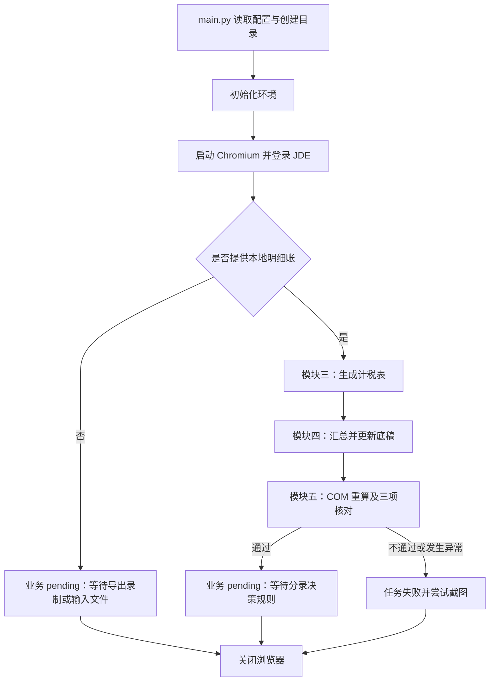

# JDE 房产税 RPA 程序说明文档

## 2026-10-23 新版需求调整

以下说明覆盖正文中的旧版模块四、五规则。当前模板为 `data/房产税计税表 太古汇 202609更新.xlsx`，需求来源为 `data/需求整理.docx`。

- 模块四从计算底稿 Check 区 M:O 读取单据类型及账号，不再从审核底稿读取收入科目。空白类型汇总账号全部记录，指定类型仅汇总该类型，“非XX”排除该类型；账号忽略首尾空格，默认精确匹配。
- Check 区条件及说明保留，P 列更新为实时汇总公式。同 BU、同筛选条件合并后以负号转换为计税收入；不同条件分别成行。C、D 列、MOH、合计及借贷引用同步更新。
- 配置 `房产税配置.R55GL1005文件`（输入目录相对路径或绝对路径）可指定本期报表位置，未配置时保存到输出目录；JDE 原始 `.xls` 会保留，并转换成 `.xlsx` 供后续底稿处理。可选 `房产税配置.R55GL1005工作表` 指定工作表，也可注入上下文 `jde_r55gl1005_path`。
- 本期报表保存至 R55GL1005 页，按 Cat23 分组边界提取主营业务收入、其他业务收入及子科目至审核底稿 B:I，按 Credits-Debits 更新本月发生额。模板中的科目标识和蓝色分类随记录移动，重建命名区域“蓝色”及 N8:N14 公式。未分类的新科目会阻断，须在模板审核底稿补充并复核分类后重跑。
- 重算后同时核对税额合计与借项汇总、计税收入合计与审核底稿计税收入加 MOH、审核差额及 Check 明细汇总。任一不符禁止进入分录。分录页面操作仍待实现，核对通过后维持 pending。

`check_update.py` 和 `audit_update.py` 实现新逻辑；`template_update.update_legacy()` 仅保留旧算法用于旧版回归，正式入口不调用它。源需求和示例文件不会被覆盖。

编写日期：2026-10-22。本文依据当前工作区源代码编写，面向使用、运维及后续开发人员；功能状态以代码实现为准。

## 1. 程序概述

本项目采用 Python 开发，通过 Playwright 操作 JDE 网页，通过 openpyxl 处理 Excel 工作簿，通过 Windows COM 调用办公软件重算公式，完成从租房产税底稿的数据整理与核对。

当前业务链路为：读取配置 → 初始化环境 → 登录 JDE → 导出明细账及 R55GL1005 → 生成计税表 → 更新收入及税额公式 → 重算并核对 → 等待分录决策规则。

### 1.1 当前实现范围

| 模块 | 当前能力 | 实现状态 |
| --- | --- | --- |
| 一：登录 JDE | 从 Windows 通用凭据读取账号密码，填写环境、角色并登录 | 已实现 |
| 二：导出明细账 | 登录后依次导出明细账与 R55GL1005 报表 | 已实现 |
| 三：生成计税表 | 按标题导入明细账，保留模板其他工作表及公式 | 已实现 |
| 四：更新底稿 | 按 BU、完整收入科目及单据类型汇总，更新计税及分录引用 | 已实现，依赖约定模板布局 |
| 五：重算核对 | 重算工作簿并输出三项金额核对结果 | 已实现；核对通过后的分录决策待补充 |
| 六：写入分录 | 预留业务入口 | 尚未实现 |

**任务正常退出不等于业务全部完成。** 缺少本地明细账时，以及模板核对通过但缺少分录规则时，业务流程会进入 `pending`；主任务仍可能返回成功，命令退出码为 `0`。目前不能仅用退出码判断是否已完成导出或记账。

## 2. 项目结构与职责

```text
项目根目录/
├── main.py                         主程序入口
├── record_jde.py                   登录后打开 Playwright Inspector
├── keep_awake.py                   独立运行的定时鼠标微动工具
├── requirements.txt                Python 依赖清单
├── config/
│   ├── config.py                   配置合并、目录生成与配置归档
│   ├── config_loader.py            Excel 配置读取及 ConfigError
│   └── property_tax_ledger_headers.json  明细账模板标题定义
├── core/
│   ├── task_base.py                任务执行、日志、状态与耗时管理
│   ├── context.py                  共享配置、业务数据与浏览器实例
│   └── task_manager.py             可选串行任务管理器
├── workflows/jde_flow/
│   ├── main_task.py                JDE 主任务编排及资源释放
│   ├── login_task.py               获取凭据并执行登录
│   ├── property_tax.py             房产税流程编排、模板生成和结果保存
│   ├── template_update.py          收入汇总与底稿公式更新
│   └── template_check.py           COM 重算及金额核对
├── web/
│   ├── browser.py                 Playwright 浏览器封装
│   ├── base_page.py               通用网页操作封装
│   └── JDE/jde_function.py         JDE 登录与待完善的下载函数
├── data_processing/excel.py        通用 Excel 读写封装
├── client/                         Windows 客户端自动化封装
├── utils/                          凭据、文件、截图及辅助函数
├── init/init.py                    环境初始化、可选分辨率设置函数
├── log/loggingConfig.py            日志初始化
├── data/                          配置文件及示例工作簿
└── tests/                         单元测试
```

当前主流程直接使用 openpyxl 处理房产税工作簿；`client/`、`BasePage`、通用 Excel 工具和 `TaskManager` 是可复用组件，未作为当前房产税主链路的核心调用入口。

## 3. 环境与安装

### 3.1 运行条件

- Windows 桌面环境：入口初始化、通用凭据、COM 重算等依赖 Windows。
- Python 3：项目未固定具体版本，应在目标环境验证依赖兼容性。
- 可访问目标 JDE 系统的网络环境。
- 当前运行 Windows 用户下已保存对应的通用凭据。
- 模块五默认需要安装支持 `Excel.Application` COM 接口的 Microsoft Excel。

依赖包括 `openpyxl>=3.1.0`、`Pillow>=10.0.0`、`psutil>=5.9.0`、`pywin32>=305`、`playwright>=1.40.0`、`uiautomation>=2.0.0`，以 `requirements.txt` 为准。

### 3.2 安装步骤

在项目根目录执行：

```powershell
python -m venv .venv
.\.venv\Scripts\Activate.ps1
python -m pip install -r requirements.txt
python -m playwright install chromium
```

## 4. 配置说明

### 4.1 配置文件及优先级

主入口加载 `data/UserConfig.xlsx` 与 `data/Config.xlsx`，两个文件均需存在。每个工作表第 1 行作为标题，从第 2 行读取 A 列配置项、B 列配置值；C 列可放填写说明，程序不读取该列。

同一工作表同名配置项以 `UserConfig.xlsx` 为优先。A 列为空或 B 列为 `None` 的行不载入。程序使用 `工作表名.配置项` 访问配置，例如 `JDE配置.jde_url`。

### 4.2 基础配置与目录配置

| 工作表 | 配置项 | 默认值及说明 |
| --- | --- | --- |
| 基础配置 | 项目名称 | `JDE流程`，用于日志及工作目录名称 |
| 基础配置 | 基础路径 | `./data`；相对路径按配置文件所在目录的上一级解析，默认文件位置下即项目根目录 |
| 基础配置 | 初始化进程列表 | 默认为空；支持英文或中文逗号分隔 |
| 目录配置 | 配置目录 | `01_配置` |
| 目录配置 | 输入目录 | `02_输入` |
| 目录配置 | 输出目录 | `03_输出` |
| 目录配置 | 日志目录 | `04_日志` |
| 目录配置 | 截图目录 | `05_错误截图` |
| 目录配置 | 临时目录 | `06_临时文件` |

工作目录结构为 `基础路径/项目名称/目录名称`。初始化时会创建上述目录，并将两个源配置工作簿复制到配置目录归档。

`initEnv()` 会按进程名称的**子串匹配**终止配置列表中的进程。例如配置 `excel` 会匹配名称中包含该文本的进程，启动前应保存相应应用中的工作。`set_resolution()` 虽已定义，但当前 `main.py` 未调用。

### 4.3 JDE配置

| 配置项 | 必填 | 说明 |
| --- | --- | --- |
| jde_url | 是 | JDE 登录地址；主任务启动前校验不能为空 |
| jde_credential_name | 是 | Windows 凭据管理器中“通用凭据”的目标名称 |
| jde_environment | 否 | 登录环境，非空时填写 |
| jde_role | 否 | 登录角色，非空时填写 |
| headless | 否 | 默认 `False`；字符串接受 true/false、1/0、yes/no，不区分大小写 |

登录时，环境变量 `JDE_URL`、`JDE_ENVIRONMENT`、`JDE_ROLE` 分别覆盖对应配置值。即使设置了 `JDE_URL`，主任务仍要求配置文件中的 `jde_url` 非空。

账号密码不从上述环境变量读取。`utils/credentials.py` 使用当前 Windows 用户的 `CredRead(..., CRED_TYPE_GENERIC, ...)` 获取凭据；字节密码按 UTF-16-LE 解码。凭据不存在、无法读取或内容为空均停止登录。

配置凭据时，在 Windows“凭据管理器 → Windows 凭据 → 添加普通凭据”中保存目标名称、用户名和密码，再将目标名称填写到 `jde_credential_name`。

### 4.4 房产税配置

在任一配置工作簿中建立 `房产税配置` 工作表：

| 配置项 | 默认值 / 填写规则 |
| --- | --- |
| 公司 | 生成输出时必填，用于文件名；有前导零时用文本存储 |
| 会计期间 | 生成输出时必填，例如 `2026-10`；用于文件名 |
| 模板文件 | 可选；相对输入目录或填写绝对路径；留空时输入目录必须只有一个匹配的模板 |
| 明细账文件 | 当前替代自动导出的本地文件；相对输入目录或填写绝对路径 |
| 明细账工作表 | 默认使用源文件第一张工作表 |    
| 明细账标题行 | 默认 `1`，须为正整数 |
| 模板标题行 | 默认读取标题定义文件，当前为 `1`，须为正整数 |
| 标题映射 | 可选 JSON 对象，方向为“源标题 → 模板标题”，例如 `{"源科目":"帐号"}` |
| 输出目录 | 留空使用框架输出目录；相对路径作为框架输出目录的子目录 |
| 收入科目匹配方式 | 默认 `精确`；也可填写 `包含子科目` |
| 重算引擎 | 默认 `Excel.Application`；模块三用它复制模板写入明细并重算，WPS 可配置 `ket.Application`，接口兼容性需现场验证；配置 `openpyxl` 可跳过 COM，但会丢失图片、数据验证等对象 |
| 核对容差 | 默认 `0.00`；必须为有限的非负金额 |

公司和会计期间不能包含 Windows 文件名非法字符。当前代码只用这两项生成文件名，**不会据此自动填写模板中的公司或会计期间单元格**；运行前应核实模板 `C4` 等业务字段。

模块三支持配置模板标题行，但模块四仍按 `JDE明细账` 和审核底稿的第 1 行读取标题；完整运行时应保持这两张表的标题在第 1 行。

## 5. 主流程与业务规则



### 5.1 登录与浏览器管理

`JDEMainTask.execute()` 校验配置后创建 Chromium 浏览器，将实例注册到上下文，再执行 `JDELoginTask`。登录后浏览器继续供后续模块复用，主任务退出时通过 `finally` 关闭。

`jde_login()` 先打开登录地址，若 `#drop_mainmenu` 已可见则视为已登录；否则按需展开 `Details`，填写 Environment、Role、User ID、Password 并点击 Sign In，等待主菜单出现。

登录装饰器最多执行 3 次尝试，两次尝试之间等待 5 秒。该重试只包裹登录函数，不覆盖整个房产税流程。

### 5.2 模块二：获取明细账

明细账导出后返回主页，重新执行“选择页面 → 所有页面 → 总帐”，然后从实际包含菜单项的页面或 iframe 定位并点击“中方科目总账”，运行 R55GL1005 并下载报表。该菜单定位会扫描当前所有 frame，避免假设菜单链接位于主文档或 `e1menuAppIframe`。

提交后作业号每次都不同，因此按“已提交作业列表第一行（本次提交）”确定目标行并记录其作业号，再轮询该行状态直至“完成”，轮询总时长上限 120 秒；超时或状态为错误时直接报错，不会下载未完成或上一轮的报表。该界面不会自动刷新状态，轮询期间每 5 秒在“作业”框重新填入 `R55GL1005_TKHXLS001` 并回车，让列表重新查询。

明细账保存路径由 `房产税配置.明细账文件` 指定；R55GL1005 路径优先读取上下文 `jde_r55gl1005_path`，其次读取 `房产税配置.R55GL1005文件`，都未提供时保存到输出目录。配置的相对路径按输入目录解析，绝对路径按指定位置保存。原始 `.xls` 保留在指定路径，另生成同名 `.xlsx` 用于后续 openpyxl 底稿处理。JDE 导出的 `.xls` 自带宏，打开时提示“宏已被禁用”：转换时先把文件复制到 Excel 受信任位置（从注册表读取可写目录，跳过 XLSTART 以免 Excel 启动时自动加载），再以 `AutomationSecurity=1` 打开，等同点击“启用内容”。**关键是不能关闭 `EnableEvents`**——模板的处理逻辑挂在 `Workbook_Open` 事件上，关闭事件后宏不执行，读到的就是未处理的数据（实测会多出一列行号和末尾空白行列）。随后优先让 Excel 直接另存为 `.xlsx` 以保留格式；若本机安全策略阻止另存（不报错也不生成文件），退回读取单元格值用 openpyxl 重建：保留数值、文本与原行列位置，裁掉末尾空行空列，公式与单元格格式不保留。受信任目录中的临时文件在转换后删除，日志会打印每个工作表的行列数，可与手工“启用内容后另存”的结果比对。两份工作簿随后分别用于生成计税表和更新 R55GL1005 审核底稿。

### 5.3 模块三：生成计税表

1. 读取显式配置的模板；未配置时，在输入目录查找名称包含“房产税计税表”的 `.xlsx`，排除 `~$` 临时文件及明细账本身，要求唯一匹配。
2. 根据 `config/property_tax_ledger_headers.json` 校验 `JDE明细账` 的模板标题集合。当前定义记录 46 列，示例位置为 `A1:AT1`。
3. 按标题匹配源列和目标列：同名自动匹配，JSON 中已确认的源标题提供默认别名，运行配置的标题映射优先。
4. 标题去除首尾空格，保留内部空格；源列可调整顺序。缺列、多余未映射源列、重复标题或多个源列指向同一目标列均停止。
5. 清空目标明细区旧值，跳过全空源行，沿用模板首条明细的单元格样式。文本按字符串写入，可保留文本本身的前导零；数值源数据已丢失的前导零不会自动恢复。
6. 保留其他工作表和公式，通过输出目录内临时文件保存后重命名。

输出命名为 `房产税计税表 公司 会计期间.xlsx`。同名输出已存在，或输出与模板、明细账路径重合时拒绝执行。源文件按 `data_only

### 5.4 模块四：更新底稿

必须存在以下工作表与字段：

| 工作表 | 所需内容 |
| --- | --- |
| 房产税（从租）审核底稿 | 第 1 行含 `BU`、`收入科目`；BU 合并单元格读取左上角值 |
| JDE明细账 | 第 1 行含 `帐号`、`单据 类型`、`分类帐类型 1 金额`、`帐户 说明`，并符合模块三标题定义 |
| 房产税（从租）计算底稿 | 兼容示例布局：B9 起汇总，B 列唯一“合计”，G:I 分录区，M:P Check 区 |
| MOH | 提供固定 BU 250108 所需的期间及金额数据 |

主要规则如下：

- 审核底稿的同一收入科目重复出现只计一次；同一科目对应多个 BU 时停止。
- 默认按完整科目精确匹配。`包含子科目` 模式额外匹配以 `审核科目 + "."` 开头的科目；匹配到多个不同 BU 时停止。
- 用 `Decimal` 按 `(BU, 单据类型, 完整科目)` 累加原始带符号金额；金额为空、非数值、非有限值或单据类型为空时停止。
- 每个完整科目及单据类型独占一行，同 BU 不合并。BU 按审核底稿出现顺序，科目升序，同科目的单据类型按文本降序排列。
- B 列写 BU，C 列写原始汇总金额取反，D 列写 `=ROUND(C当前行*$C$8,2)`。
- 固定 BU `250108` 不从明细账生成汇总，固定放在明细区最后且只出现一次。保留其 MOH 公式；缺行或原值非公式时生成 `=LOOKUP($C$4,MOH!$E$6:$AF$6,MOH!$E$7:$AF$7)`。
- 明细行数变化时重建收入、税额合计公式；按 G 列以 `.917013` 结尾的分录账号更新 H 列借项引用；调整 I 列相关 D 列引用，已移除金额引用归零。
- Check 区从 M5:P5 开始写入单据类型、账户说明、完整科目和原始带符号汇总金额，并生成 P 列合计。

模块四按约定坐标更新，未实现任意模板布局自动适配。税率取模板 `$C$8`，并非在 Python 中固定税率。

### 5.5 模块五：重算与核对

重算使用 `DispatchEx` 创建独立办公软件实例，禁用宏、关闭外部链接更新，调用 `CalculateFullRebuild()` 后保存并关闭。openpyxl 自身不计算公式。

随后按 `data_only=True` 重新加载生成文件，使用表头和“合计”等标记定位数据，核对：

| 核对项 | 规则 |
| --- | --- |
| 税额合计 | 等于账号以 `.917013` 结尾的借项金额汇总 |
| 收入合计 | 等于 Check 合计取反，包含固定 BU 250108，不另行扣减 |
| Check 合计 | 等于 Check 明细金额之和 |

判断条件为 `abs(左值 - 右值) <= 核对容差`。数值缺失、错误公式结果或无法唯一定位标记时停止，不使用历史缓存跳过重算。

核对完成后输出同名 `.核对结果.json`，记录核对项、左值、右值、差额、容差、通过标志及实际位置。若在重算、定位或取数阶段已异常，报告可能尚未生成。

三项全部通过后，当前实现仍主动进入 `pending`，等待“是否需要写入分录”的业务规则；模块六不会实际执行。

## 6. 使用步骤

### 6.1 常规运行

1. 完成依赖安装与 Chromium 安装。
2. 准备两个配置工作簿及 Windows 通用凭据。
3. 在配置指定的输入目录放入模板和本地明细账，填写公司、会计期间及文件路径。
4. 核实模板中的期间、税率、审核科目、MOH 数据及约定布局。
5. 在项目根目录执行主程序：

```powershell
python main.py
```

6. 检查运行日志中的待处理原因、生成工作簿及核对报告。需要再次运行时，应先归档原输出或调整期间等配置；程序不覆盖已有同名输出。

### 6.2 录制 JDE 后续操作

```powershell
python record_jde.py
python record_jde.py --credential-name "JDE凭据目标名称"
```

录制脚本加载同样的配置，强制使用有界面浏览器，自动登录后调用 `page.pause()` 打开 Inspector。点击 Record 录制后续操作，复制生成的 Python 代码，点击 Resume 结束会话。`--credential-name` 仅覆盖本次使用的凭据名，不修改工作簿；录制结果不会自动写入业务代码。

### 6.3 鼠标微动辅助工具

```powershell
python keep_awake.py
python keep_awake.py -i 10
python keep_awake.py --duration 3600
```

该工具独立运行，默认每 30 秒检查鼠标位置；位置未变时微动后复位，按 `Ctrl+C` 停止。它未接入主程序，也不能保证覆盖系统或组织配置的全部锁屏策略。当前时长检查位于微动之后，因此用户持续移动鼠标时，退出可能晚于指定时长。

## 7. 输出、状态与错误处理

### 7.1 文件输出

| 输出 | 位置 / 说明 |
| --- | --- |
| 计税工作簿 | 房产税输出目录下的 `房产税计税表 公司 会计期间.xlsx` |
| 核对报告 | 与计税工作簿同目录、同名的 `.核对结果.json` |
| 配置归档 | 框架配置目录中的源配置工作簿副本 |
| 运行日志 | 默认当前工作目录 `log_data/YYYYMMDD_机器名.log` |
| 主任务异常截图 | 框架截图目录中的 `jde_failure.png`，页面可用时尝试保存 |

配置中的 `04_日志` 目录会创建，但当前 logger 实际使用 `config/config.py` 的 `PYHON_LOG_FOLDER_PATH = "./log_data/"`，不会自动转入该业务日志目录。同名错误截图可能被后续失败覆盖。

### 7.2 上下文关键字段

这些字段通过 `context.set()/get()` 使用，当前保存在内存中，未形成持久化状态文件。

| 字段 | 含义 |
| --- | --- |
| jde_logged_in | 登录任务成功标记 |
| jde_ledger_path | 可由调用方预先注入的本地明细账路径 |
| property_tax_path | 生成的计税表路径 |
| jde_ledger_rows / jde_ledger_mapping | 导入行数及源到目标标题映射 |
| property_tax_bu_totals | BU、科目、单据类型及汇总金额记录 |
| property_tax_status | `running`、`pending`、`failed` 或 `completed` |
| property_tax_pending_reason | 业务待处理原因 |
| property_tax_check_status | `running`、`passed` 或 `failed` |
| property_tax_check_results / property_tax_check_report | 核对记录及报告路径 |
| journal_required | 预留的分录决策字段，当前核对实现不会正常返回布尔决策 |

`TaskBase.run()` 将正常返回的 `execute()` 标记为 `completed` 并返回 `True`，异常时标记为 `failed` 并返回 `False`；它不会把 `execute()` 的布尔返回值直接作为成功判断。扩展任务时应注意这一约定，尤其是可选 `TaskManager` 中的失败传播。

主任务发生异常时尝试截图，随后释放浏览器；环境初始化或配置加载发生在主任务之前，此阶段失败不经过主任务截图逻辑。已生成的工作簿不会因后续核对失败自动回滚或删除。

## 8. 常见问题

| 现象 | 排查方法 |
| --- | --- |
| 配置文件不存在 | 检查项目 `data` 下的两个配置工作簿及入口路径常量 |
| 无法读取 Windows 通用凭据 | 检查目标名称、凭据类别、当前运行账号及 pywin32 安装 |
| 浏览器无法启动 | 检查 Playwright 依赖和 Chromium 是否已安装 |
| JDE 登录重试后失败 | 检查地址、环境、角色、凭据及登录页面控件是否变化 |
| 业务停在模块二 pending | 配置本地明细账；自动导出尚未接入 |
| 模板不唯一 | 显式填写“模板文件”，或整理输入目录中的匹配文件 |
| 标题缺失或未映射 | 对照标题定义检查源表，补充已确认的异名映射并保留内部空格 |
| 输出文件已存在 | 归档旧输出或调整输出配置后再运行 |
| 收入科目未匹配 | 检查完整科目、审核底稿 BU、匹配方式和源数据 |
| COM 重算失败或文件只读 | 检查 Excel/重算引擎注册、文件占用及写入权限 |
| 核对无法取数 | 检查公式、MOH 数据、表头标记及办公软件实际重算结果 |
| 核对金额不符 | 查看 JSON 中两侧数值与位置，复核金额符号、税额及固定 BU |
| 核对通过却未写入 JDE | 当前属于预期状态，需继续实现分录规则及页面操作 |

## 9. 测试与后续维护

执行现有单元测试：

```powershell
python -m unittest discover -s tests -v
```

现有测试覆盖凭据读取、JDE 任务及浏览器清理、录制入口、模板标题映射、收入汇总、固定 BU、动态行数公式和金额核对等。部分外部调用使用 mock，单元测试通过不能代替真实 JDE 页面、Windows 凭据及 Excel COM 的现场验证。本文编写过程未执行真实业务登录、导出、重算或记账。

后续开发建议按以下顺序推进：

1. 录制并完善明细账导出，将下载文件路径接入 `export_ledger()`。
2. 根据真实源文件确认标题别名，更新标题定义 JSON 或配置映射。
3. 明确核对通过后的分录决策，使 `compare_values()` 返回明确布尔值。
4. 实现 `write_journal()` 的字段填写、提交及结果确认。
5. 补充可持久化的业务完成状态，使运行调度能够区分 `pending` 与全部完成。

当前 `README.md` 存在 Git 合并冲突标记；本说明独立保存，维护时可再整理 README 导航及冲突内容。
